# Stash screenshots (claude-project-thread-onjzx1, c3ac384)

## 01-home

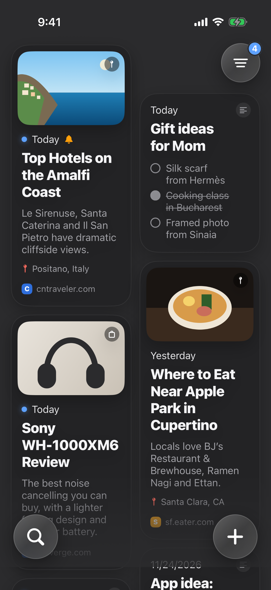

## 02-filter-menu

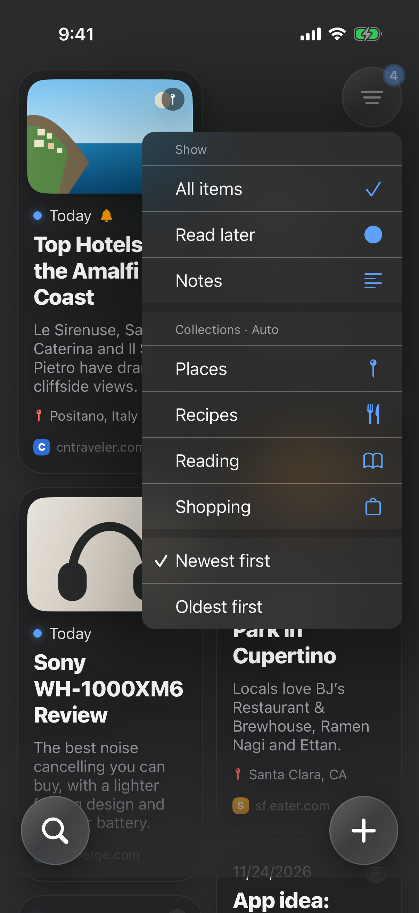

## 03-places

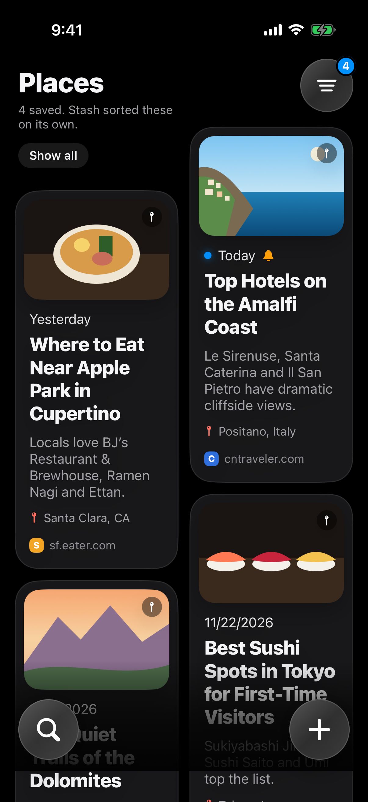

## 04-detail

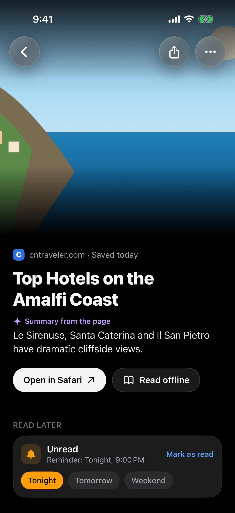

## 05-detail-location

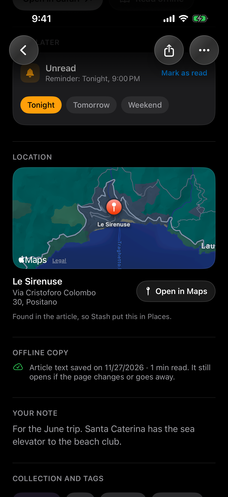

## 06-reader

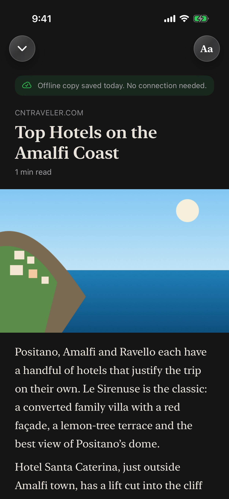

## 07-search

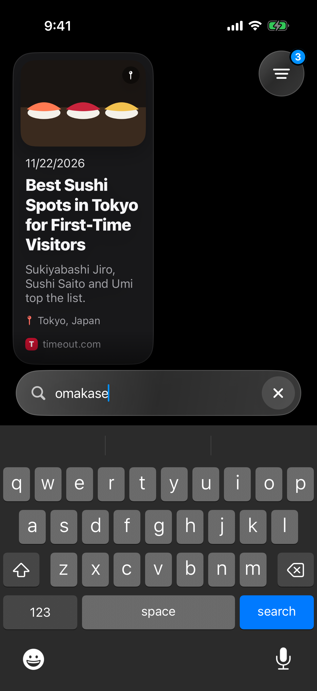

## 08-add-link-empty

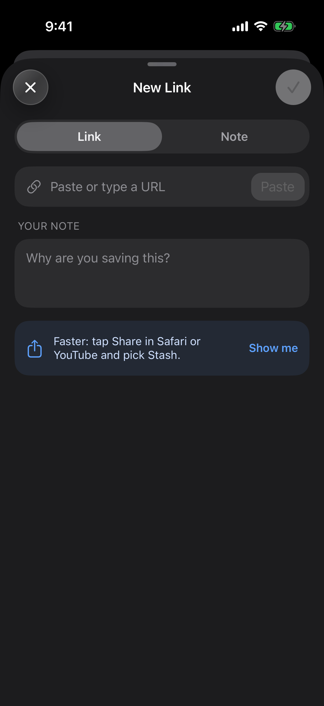

## 09-add-link-preview

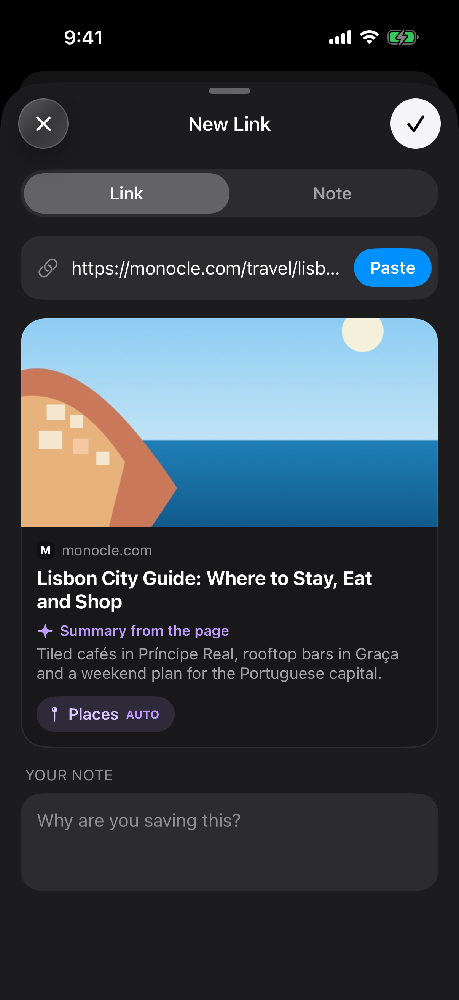

## 10-home-after-save

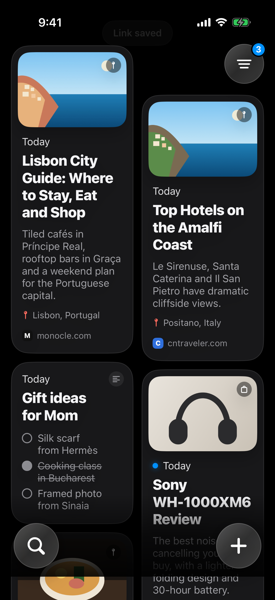

## 11-saved-link-detail

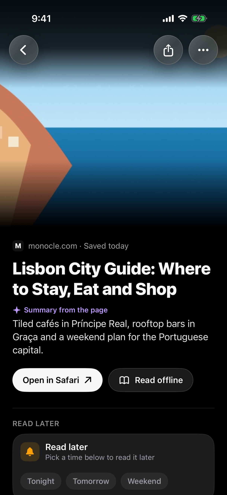

## 12-new-note

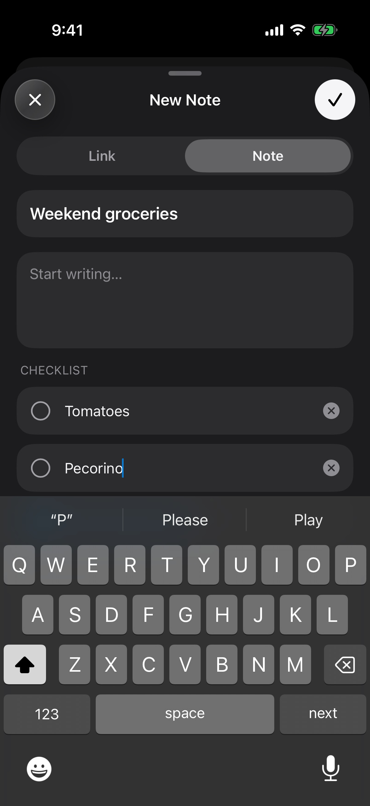

## 13-note-detail

## 15-reminder-set

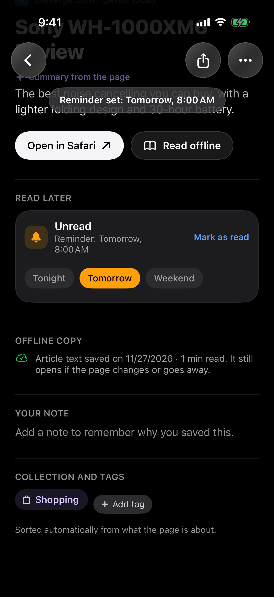

## 16-read-later

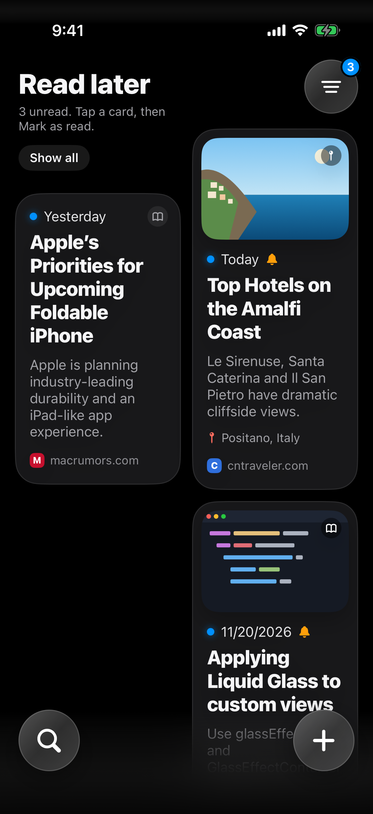
